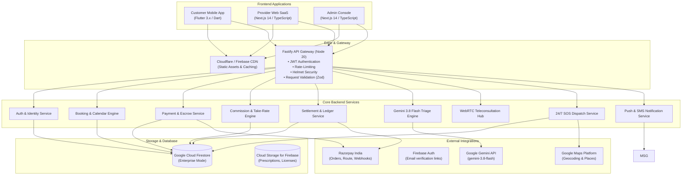

# PETWO — Architecture Design Document

## 1. System Vision & Paradigm

PETWO is designed as a hybrid **B2C Marketplace** and **Multi-Tenant B2B SaaS Platform** for veterinary clinics, hospitals, independent veterinarians, groomers, boarding resorts, and diagnostics centers. The platform enforces strict tenant isolation, financial accuracy, and data privacy while maintaining a single, unified discovery and booking engine for pet owners.

---

## 2. Component Topology

---

## 3. Multi-Tenancy Architecture

PETWO implements a **Logical Multi-Tenancy Model** built on Cloud Firestore:

1. **Tenant Representation**: Each provider organization (e.g. `TailBlazers Specialty Pet Hospital`) is an independent tenant assigned a unique `providerId`.
2. **Sub-facility Scoping**: A provider can operate multiple locations (`providerLocations`), each with independent geo-coordinates, operating schedules, and staff assignments.
3. **Staff Roles**: Staff accounts belong to a specific tenant and location with restricted calendar and appointment access.
4. **Data Isolation**:
   - Provider analytics, earnings ledger, client records, and service pricing are filtered at the database level using Firebase Security Rules and API middleware (`isProvider`).
   - Pet medical records are shielded: providers can only access medical histories for pets with confirmed appointments at their facility.

---

## 4. Technology Stack Selection Rationale

| Layer | Chosen Technology | Justification |
|---|---|---|
| **Mobile App** | **Flutter 3.x** | Single Dart codebase producing high-performance native iOS and Android experiences with Material 3 styling and direct device hardware access (Camera, GPS, Razorpay Native SDK). |
| **Provider & Admin Web** | **Next.js 14 (App Router)** | React Server Components (RSC) for instantaneous page loads, server-side data fetching, strong SEO for public provider profiles, and seamless TypeScript type sharing with `@petwo/shared`. |
| **Backend Framework** | **Fastify + TypeScript** | 2-3x faster throughput than Express, built-in schema validation via Ajv/Zod, native async/await lifecycle hooks, and low memory overhead. |
| **Primary Database** | **Cloud Firestore (Enterprise)** | Managed NoSQL with millisecond low latency, automatic horizontal scaling, offline SDK synchronization, real-time snapshot listeners for live appointment queues, and granular rule enforcement. |
| **Payments** | **Razorpay Route & Smart Collect** | Optimal payment gateway for the Indian market supporting UPI AutoPay, cards, net banking, split marketplace commissions, and automated vendor payouts. |
| **AI Intelligence** | **Google Gemini 3.8 Flash** | Fast latency (<1s response), structured JSON schema output, high medical and contextual reasoning capabilities for preliminary pet symptom triage. |

---

## 5. Security & Boundary Architecture

1. **Transport Layer**: Strict HTTPS / TLS 1.3 encryption across all public endpoints with HTTP Strict Transport Security (HSTS).
2. **Authentication**:
   - Customer and Provider Firebase Email/Password authentication with verification links and signed Firebase ID tokens. Phone numbers are contact details only.
   - JWT tokens verified in `auth.middleware.ts` on every privileged endpoint.
3. **Authorization Matrix**:
   - `customer`: Access to own pets, own bookings, payment orders, public provider search, reviews authoring.
   - `provider`: Access to tenant staff, service catalogue, booking calendar, earnings ledger, public review responses.
   - `admin` / `super_admin`: Platform-wide oversight, provider compliance audits, commission policy tuning, audit trails.
4. **Idempotent Webhooks**: All external Razorpay webhooks require cryptographic signature validation (`HMAC-SHA256`) and are processed idempotently based on payment event IDs.
5. **Auditing**: Sensitive administrative actions (provider approval, commission rate changes, refunds) are written to an immutable `auditLogs` collection with client IP and before/after diffs.
