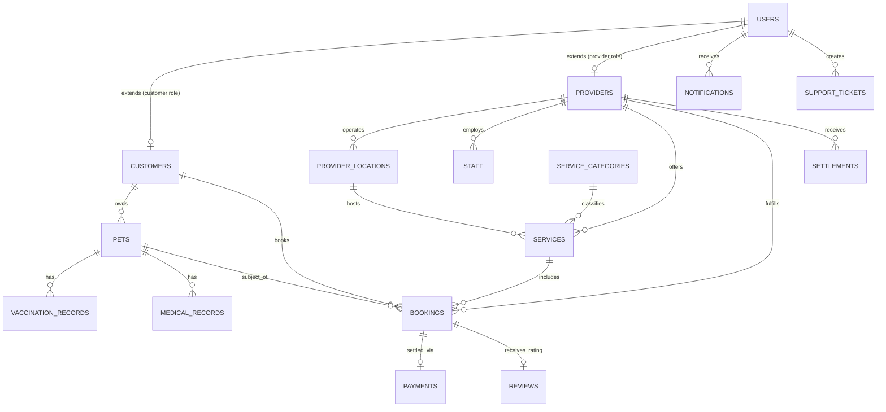

# PETCO — Database Schema Specification

This document provides the full data dictionary and entity design for Cloud Firestore Enterprise mode.

---

## 1. Entity-Relationship Model

---

## 2. Collection Data Dictionary

### 2.1 `users/{userId}`
Root authentication record mapping directly to Firebase Auth UID.

| Field | Type | Description |
|---|---|---|
| `id` | `string` | Unique Firebase User UID |
| `phone` | `string` | Normalized E.164 phone (`+919876543210`) |
| `email` | `string?` | Optional official email address |
| `displayName` | `string` | Name for display |
| `role` | `enum` | `'customer' \| 'provider' \| 'admin' \| 'super_admin'` |
| `isActive` | `boolean` | Account active flag |
| `isEmailVerified`| `boolean` | Verification status |
| `createdAt` | `string` | ISO 8601 creation timestamp |
| `updatedAt` | `string` | ISO 8601 last updated timestamp |

### 2.2 `customers/{customerId}`
Extended profile for pet parents.

| Field | Type | Description |
|---|---|---|
| `id` | `string` | Customer ID (matches `userId`) |
| `userId` | `string` | Foreign key to `users/{userId}` |
| `firstName` | `string` | Given name |
| `lastName` | `string` | Family name |
| `savedProviders` | `string[]` | Array of favored `providerId`s |
| `address` | `map?` | Home address with lat/lng coordinates |
| `notificationPreferences` | `map` | SMS, Email, Push toggles |

### 2.3 `pets/{petId}`
Pet profile details.

| Field | Type | Description |
|---|---|---|
| `id` | `string` | Nanoid pet identifier |
| `ownerId` | `string` | Foreign key to `customers/{id}` |
| `name` | `string` | Pet name |
| `species` | `enum` | `'dog' \| 'cat' \| 'bird' \| 'rabbit' \| 'hamster' \| 'fish' \| 'reptile' \| 'other'` |
| `breed` | `string` | Breed description |
| `gender` | `enum` | `'male' \| 'female' \| 'unknown'` |
| `dob` | `string?` | Date of birth (YYYY-MM-DD) |
| `weight` | `number?` | Weight in kilograms |
| `allergies` | `string[]` | List of documented drug/food allergies |
| `specialNotes` | `string?` | Behavioral or special care instructions |
| `isActive` | `boolean` | Soft-deletion flag |

### 2.4 `providers/{providerId}`
Registered provider businesses and solo practitioners.

| Field | Type | Description |
|---|---|---|
| `id` | `string` | Provider ID (matches `userId`) |
| `businessName` | `string` | Legal or trade business name |
| `businessType` | `enum` | `'individual_vet' \| 'veterinary_clinic' \| 'veterinary_hospital' \| 'grooming_salon' \| 'boarding_facility' \| 'daycare_facility' \| 'diagnostic_centre' \| 'pet_trainer'` |
| `verificationStatus` | `enum` | `'pending' \| 'under_review' \| 'approved' \| 'rejected' \| 'suspended'` |
| `registrationNo` | `string?` | VCI or State Veterinary Council registration |
| `panNumber` | `string?` | 10-character Indian Permanent Account Number |
| `gstNumber` | `string?` | 15-character GSTIN |
| `subscription` | `map` | Tier (`'starter' \| 'growth' \| 'pro'`), status, billing dates |
| `rating` | `number` | Aggregated score (1.0–5.0) |
| `reviewCount` | `number` | Count of verified reviews |
| `isFeatured` | `boolean` | Priority marketplace placement |

### 2.5 `services/{serviceId}`
Specific service offerings published by providers.

| Field | Type | Description |
|---|---|---|
| `id` | `string` | Nanoid service identifier |
| `providerId` | `string` | Foreign key to `providers/{id}` |
| `locationId` | `string` | Foreign key to `providerLocations/{id}` |
| `categoryId` | `string` | Foreign key to `serviceCategories/{id}` |
| `name` | `string` | Service title (e.g. "Full Grooming & Spa") |
| `price.amount` | `number` | **Integer paisa** (₹1 = 100 paisa) |
| `price.currency` | `string` | Always `'INR'` |
| `price.priceType` | `enum` | `'fixed' \| 'starting_from' \| 'per_hour' \| 'per_night'` |
| `duration` | `number` | Slot duration in minutes |
| `isActive` | `boolean` | Availability toggle |

### 2.6 `bookings/{bookingId}`
Transactional appointments and reservations.

| Field | Type | Description |
|---|---|---|
| `id` | `string` | Nanoid booking identifier |
| `bookingNumber` | `string` | Human-readable identifier (`PTC-YYYYMMDD-XXXX`) |
| `bookingType` | `enum` | `'appointment' \| 'boarding' \| 'home_service'` |
| `customerId` | `string` | Pet parent UID |
| `providerId` | `string` | Provider UID |
| `petId` | `string` | Pet profile ID |
| `serviceId` | `string` | Service catalog ID |
| `status` | `enum` | `'pending_confirmation' \| 'confirmed' \| 'in_progress' \| 'completed' \| 'cancelled_by_customer' \| 'cancelled_by_provider' \| 'no_show' \| 'refunded'` |
| `scheduledAt` | `string` | ISO 8601 start datetime |
| `scheduledEnd` | `string` | ISO 8601 end datetime |
| `pricing.totalAmount` | `number` | Final charged amount in paisa |
| `commission.rate` | `number` | Take-rate percentage (e.g. 15%) |
| `commission.amount` | `number` | Platform fee in paisa |
| `commission.netProviderAmount`| `number` | Net payable to vendor in paisa |
| `payment.status` | `enum` | `'created' \| 'captured' \| 'failed' \| 'refunded'` |

---

## 3. Composite Index Requirements

The following compound indexes are defined in `infrastructure/firebase/firestore.indexes.json` to guarantee queries perform in $<10\text{ms}$:

| Collection | Fields Indexed | Query Intent |
|---|---|---|
| `bookings` | `customerId` (ASC) + `createdAt` (DESC) | Customer booking history listing |
| `bookings` | `providerId` (ASC) + `scheduledAt` (ASC) | Provider daily calendar schedule |
| `bookings` | `providerId` (ASC) + `status` (ASC) + `scheduledAt` (ASC) | Active queue filtering |
| `providers`| `verificationStatus` (ASC) + `isActive` (ASC) + `rating` (DESC) | Public discovery rankings |
| `services` | `providerId` (ASC) + `isActive` (ASC) | Provider active catalogue lookup |
| `reviews`  | `providerId` (ASC) + `status` (ASC) + `createdAt` (DESC) | Published review feed |
| `settlements`| `providerId` (ASC) + `status` (ASC) + `createdAt` (DESC) | Vendor payout ledger |
