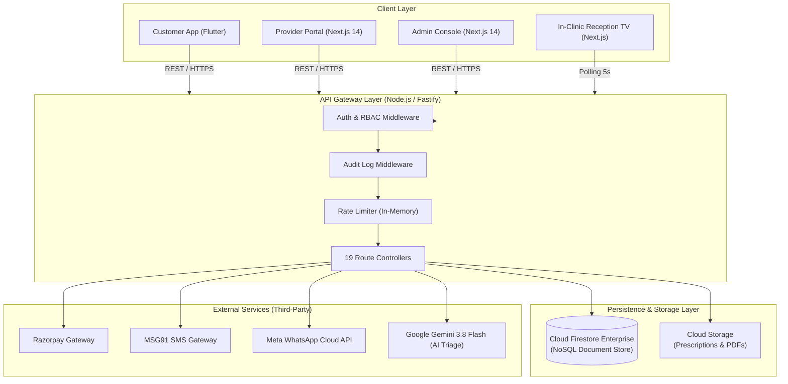
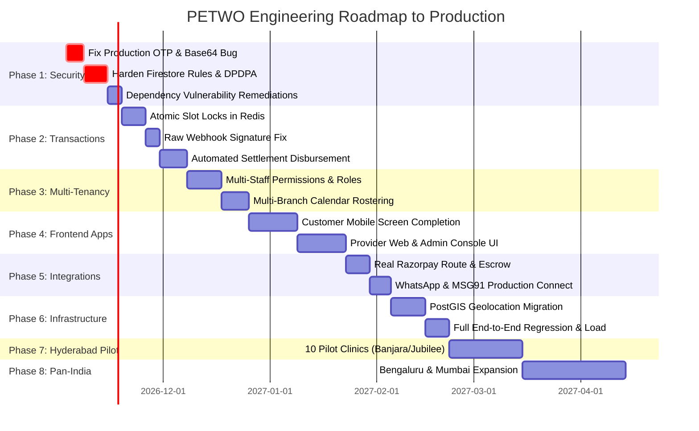

# MASTER ENGINEERING AUDIT REPORT — PETWO
## Production-Grade Pet Care Marketplace & Multi-Tenant SaaS Platform

- **Repository**: [https://github.com/Areefbaba/PETWO](https://github.com/Areefbaba/PETWO)
- **Target Market**: India (Flagship Launch: Hyderabad, Telangana)
- **Long-Term Objective**: Pan-India Scale & International Expansion
- **Audit Date**: November 2, 2026
- **Auditor Role**: Principal Software Architect, Staff Full-Stack Engineer, SaaS Architect, Database Engineer, DevSecOps Engineer, QA Automation Engineer, and Technical Product Manager.

---

## 1. Executive Summary

PETWO aims to become an enterprise-grade multi-vendor pet-care marketplace and multi-tenant SaaS operating system connecting pet owners with verified veterinary clinics, grooming salons, boarding resorts, diagnostic labs, and pet professionals.

This audit conducted a code-level, forensic inspection across all 115+ repository files, 19 Fastify REST route handlers, 3 frontend applications (Flutter customer mobile app, Next.js 14 provider SaaS portal, Next.js 14 marketplace admin console), Firestore security rules, CI/CD pipelines, and 62 automated tests.

### Overall Readiness Verdict: **NOT PRODUCTION READY — PRE-ALPHA FOUNDATION**

While the repository contains clean architectural blueprints, strict TypeScript type declarations (`shared/types/index.ts`), integer paisa currency math, and passing unit test suites, **the platform cannot be deployed to commercial production today without severe operational, financial, legal, and security failure**. 

### Critical Highlights & Primary Blockers:
1. **Critical Authentication Defect (P0)**: In `backend/src/api/routes/auth.routes.ts` (L162), OTP verification compares the raw 6-digit OTP against a Base64-encoded string in production, rendering customer and provider login **100% inoperable in production**.
2. **Double-Booking & Concurrency Race Condition (P0)**: In `backend/src/api/routes/booking.routes.ts` (L133-L152), slot conflict validation is executed outside a Firestore atomic transaction or Redis distributed lock, and only queries already-confirmed bookings. Two users booking the same doctor slot simultaneously will both succeed. Furthermore, every booking request downloads the entire historical booking collection for that clinic location into Node.js memory.
3. **Razorpay Webhook Signature Breakage (P0)**: In `backend/src/api/routes/webhook.routes.ts` (L29-L36), webhook HMAC-SHA256 signature calculation runs on `JSON.stringify(request.body)` after Fastify has already parsed the JSON, mutating whitespace and key ordering. Real Razorpay webhooks will consistently fail cryptographic verification.
4. **Missing Financial Payout Engine (P0)**: While `FINANCIAL_MODEL.md` outlines automated weekly payouts via Razorpay Route, **no code exists in the repository to generate, batch, or execute vendor settlements**. Money captured from customers will accumulate in PETWO's master account with zero automated disbursement to clinics.
5. **Major Data Privacy & DPDPA Violation (P0)**: In `infrastructure/firebase/firestore.rules` (L73-L77, L88-L93, L104-L109), any authenticated user with the role of `provider` can execute client-side queries to read **all pets, all owners, all vaccination records, and all confidential medical records across the entire marketplace**, with zero clinic-to-patient relationship checks.
6. **Illegal Clinical Prescriptions (P0)**: In `backend/src/api/routes/teleconsult.routes.ts` (L96-L120), any non-veterinary provider (e.g. dog walkers, pet groomers) can issue and digitally sign official medical prescriptions. No VCI registration verification or cryptographic signing certificate is enforced, violating the Veterinary Council of India (VCI) Act 1984.
7. **Frontend Incompleteness (P1)**: The customer Flutter app has only 5 screens (lacking authentication, provider discovery, checkout, and medical records). The Provider Web portal has only 6 screens (lacking staff management, multi-location configuration, and prescription generation). The Admin portal has only 3 pages (lacking customer CRM, dispute resolution, settlements, and audit viewers).
8. **Geospatial Search Inoperability (P1)**: `GET /api/v1/providers/search` accepts `lat`, `lng`, and `radiusKm`, but completely ignores them in Firestore queries, resulting in zero location-based proximity filtering for Hyderabad pet parents.

---

## 2. Repository Overview

The repository is organized as an npm workspace monorepo:

```
PETWO/
├── apps/
│   ├── customer-app/          # Flutter 3.22 mobile application (iOS & Android)
│   ├── provider-web/          # Next.js 14 App Router provider SaaS dashboard
│   └── admin-web/             # Next.js 14 App Router marketplace administration
├── backend/                   # Fastify Node.js / TypeScript REST API gateway
│   ├── src/
│   │   ├── api/routes/        # 19 REST route handler plugins
│   │   ├── config/            # Firebase Admin SDK, environment schema (Zod)
│   │   ├── middleware/        # Firebase JWT authentication, RBAC, audit logging
│   │   ├── services/          # External services (WhatsApp Meta Cloud API)
│   │   └── utils/             # Paisa math, Indian formatters, booking helpers
│   ├── scripts/               # Firestore seed script with Hyderabad fixtures
│   └── vitest.config.ts       # Automated test runner configuration
├── shared/                    # Shared workspace package
│   ├── types/index.ts         # 737 lines of TypeScript interfaces & enums
│   ├── constants/index.ts     # Business rules, error codes, tax rates, limits
│   └── constants/i18n.ts      # Multilingual dictionaries (EN, TE, HI)
├── infrastructure/
│   └── firebase/              # firestore.rules (311 lines), firestore.indexes.json
├── tests/                     # QA, Security, A11y, Selenium, Playwright, k6 suites
│   ├── a11y/                  # WCAG 2.1 AA accessibility audit
│   ├── api/                   # Fastify HTTP injection & latency tests
│   ├── security/              # OWASP Top 10 resilience tests
│   ├── performance/           # k6 500-VU load test scenario
│   └── e2e/                   # Selenium (Python) and Playwright (TS) suites
├── docs/                      # 10 architecture, financial, and QA markdown documents
├── .devcontainer/             # 1-click GitHub Codespaces cloud environment
├── .github/workflows/ci.yml   # Multi-package CI pipeline + Flutter APK builder
├── docker-compose.yml         # Containerized local orchestration
├── railway.toml & render.yaml # Cloud platform-as-a-service descriptors
└── package.json               # Root monorepo workspace orchestration
```

---

## 3. Existing Implementation Inventory

| Subsystem | Documented Spec | Actual Code Implementation | Status |
|---|---|---|---|
| **Customer Auth (OTP)** | MSG91 + Firebase Custom Tokens | Implemented in `auth.routes.ts`, but Base64 bug prevents verification in production | ⚠️ Broken in Prod |
| **Provider Auth** | Multi-factor VCI Onboarding | Basic phone OTP only; no password, staff login, or 2FA | ⚠️ Partial |
| **Admin Auth** | Granular Admin RBAC | Depends on manual custom claim assignment; no login screen | ⚠️ Partial |
| **Pet Profiles** | Multi-pet, species, breed, dob | CRUD implemented in `pet.routes.ts` & Flutter `pet_model.dart` | ✅ Working |
| **Vaccine Records** | Due dates, batch numbers, vets | Implemented in `pet.routes.ts`; vulnerable in `firestore.rules` | ⚠️ Security Risk |
| **Provider Search** | Geospatial radius search | `lat/lng` ignored; ratings-only Firestore query + in-memory filter | ⚠️ Incomplete |
| **Booking Creation** | Concurrency-safe slot lock | Implemented in `booking.routes.ts`, but lacks atomic transaction | 🔴 Concurrency Bug |
| **Payment Orders** | Razorpay Order Creation | Implemented in `payment.routes.ts` with integer paisa | ✅ Working |
| **Payment Verification**| HMAC verification + status update | String comparison vulnerable to timing attack; no transaction | ⚠️ Security Risk |
| **Razorpay Webhooks** | Idempotent event processing | Raw body stringified causing signature mismatch; lacks event deduplication | 🔴 Broken in Prod |
| **Vendor Settlements** | Weekly Razorpay Route payout | `GET` endpoints exist; ZERO creation/disbursement logic | 🔴 Missing |
| **Medical Consents** | DPDPA 2023 48h access tokens | Implemented in `health-passport.routes.ts`; bypassed by Firestore rules | ⚠️ Security Risk |
| **IoT Collar Radar** | Telemetry ingest & geofencing | Implemented in `iot-tracker.routes.ts` + Haversine test suite | ✅ Working |
| **Reception TV Queue** | Live Token display for clinic | Implemented in `queue.routes.ts` & Next.js `queue/[locationId]` | ✅ Working |
| **WhatsApp Integration**| Interactive booking confirmation | Service exists, but missing env vars in Zod schema; mock defaults | ⚠️ Partial |
| **Dynamic Pricing** | Off-peak saver discounts | Implemented in `yield-pricing.routes.ts` + unit tests | ✅ Working |
| **Staff Management** | Doctor schedules & permissions | Data types exist; ZERO routes, UI, or auth implemented | 🔴 Missing |
| **Boarding Inventory** | Kennel / suite capacity lock | Data types exist; ZERO inventory tracking logic | 🔴 Missing |

---

## 4. Architecture Assessment



### Architectural Deficiencies:
1. **Firestore as Primary Transactional Store**: Firestore is a NoSQL document database optimized for hierarchical reads and real-time listeners. It lacks cross-document relational foreign keys, SQL joins, aggregate index rollups, and strict schema constraints. Using Firestore as the single source of truth for marketplace financial ledgers, double-entry accounting, and calendar scheduling introduces extreme race-condition vulnerability and high cost at scale.
2. **In-Memory Rate Limiting (`@fastify/rate-limit`)**: Rate limiting is stored in local process memory. In a multi-instance container deployment (Cloud Run, Kubernetes, AWS ECS), rate counters are not shared, allowing an attacker to multiply request thresholds by the number of running container instances. Redis is mandatory.
3. **HTTP Polling for Reception TV Display**: The in-clinic TV display polls `GET /api/v1/queue/:locationId` every 5 seconds over standard HTTP. Across 500 active Hyderabad clinics with 10 operating hours daily, this generates $360,000\text{ requests/day}$ ($10.8\text{ million requests/month}$) solely for idle waiting rooms. Firestore real-time listeners or WebSockets / Server-Sent Events (SSE) should replace polling.
4. **Absence of Background Worker Queue**: Long-running or asynchronous operations (SMS dispatch, WhatsApp messages, FCM push notifications, PDF lab report generation, abandoned booking slot expirations, weekly settlement batches) are currently executed directly inside Fastify request-response handlers. A transient failure in MSG91 or Razorpay blocks the API thread or fails the user's HTTP request.

---

## 5. Comprehensive Severity Finding Catalog

### Finding F-01: Production OTP Verification Failure
- **Severity**: **P0 — Critical**
- **Classification**: Confirmed Code Defect
- **File**: [`backend/src/api/routes/auth.routes.ts`](file:///c:/Users/shaik/OneDrive/Desktop/PETWO/backend/src/api/routes/auth.routes.ts#L83-L86) and [`L162-L172`](file:///c:/Users/shaik/OneDrive/Desktop/PETWO/backend/src/api/routes/auth.routes.ts#L162-L172)
- **Existing Behaviour**:
  ```typescript
  // Line 85: Stored as base64 in production
  otp: process.env.NODE_ENV === 'development' ? otp : hashOtp(otp),
  // Line 162-163: Compared directly with raw plaintext OTP
  const storedOtp = process.env.NODE_ENV === 'development' ? otpData.otp : otpData.otp;
  if (storedOtp !== otp) { ... }
  ```
- **Expected Behaviour**: In production, the OTP must be cryptographically hashed (e.g. SHA-256 HMAC or bcrypt), and verification must hash the incoming user OTP and compare using `crypto.timingSafeEqual`.
- **Business Impact**: **Zero users (customers or providers) can log in to the application in production.**
- **Technical Risk**: Catastrophic launch failure.
- **Recommended Solution**:
  ```typescript
  function hashOtp(phone: string, otp: string): string {
    return crypto.createHmac('sha256', env.JWT_SECRET).update(`${phone}:${otp}`).digest('hex');
  }
  // In verify route:
  const expectedHash = hashOtp(normalizedPhone, otp);
  const isMatch = crypto.timingSafeEqual(Buffer.from(otpData.otp), Buffer.from(expectedHash));
  ```
- **Acceptance Criteria**: OTP verification succeeds in `NODE_ENV=production` with cryptographically hashed storage.

---

### Finding F-02: Double-Booking Concurrency Race Condition & O(N) In-Memory Query
- **Severity**: **P0 — Critical**
- **Classification**: Confirmed Code Defect & Architectural Limitation
- **File**: [`backend/src/api/routes/booking.routes.ts`](file:///c:/Users/shaik/OneDrive/Desktop/PETWO/backend/src/api/routes/booking.routes.ts#L132-L153)
- **Existing Behaviour**:
  ```typescript
  const conflictingSnapshot = await db.collection(COLLECTIONS.BOOKINGS)
    .where('providerId', '==', data.providerId)
    .where('locationId', '==', data.locationId)
    .where('status', 'in', ['confirmed', 'in_progress'])
    .get();
  ```
  The conflict check runs outside a transaction, ignores `pending_confirmation` slots being checked out, and downloads all historical bookings into Node.js memory.
- **Expected Behaviour**:
  1. Temporary slot holds (10-minute TTL) must be acquired atomically in a distributed cache (Redis) or inside a Firestore transaction.
  2. Queries must be constrained by date window (`where('scheduledAt', '>=', startOfDay).where('scheduledAt', '<=', endOfDay)`).
- **Business Impact**: Multiple pet owners book the same doctor at the same clinic for the same hour. Clinic receptionists face furious customers, and doctors are overbooked.
- **Technical Risk**: Massive memory consumption and Firestore billing spikes as booking history grows.
- **Recommended Solution**: Implement an atomic reservation lock:
  ```typescript
  const slotLockKey = `lock:slot:${data.providerId}:${data.locationId}:${data.staffId || 'general'}:${scheduledAt.unix()}`;
  const acquired = await redis.set(slotLockKey, customerId, 'NX', 'EX', 600); // 10 min hold
  if (!acquired) {
    return reply.status(409).send({ success: false, error: { code: 'BKG_001', message: 'Slot currently held by another user.' } });
  }
  ```

---

### Finding F-03: Razorpay Webhook Signature Mismatch via JSON Serialization
- **Severity**: **P0 — Critical**
- **Classification**: Confirmed Code Defect
- **File**: [`backend/src/api/routes/webhook.routes.ts`](file:///c:/Users/shaik/OneDrive/Desktop/PETWO/backend/src/api/routes/webhook.routes.ts#L29-L36)
- **Existing Behaviour**:
  ```typescript
  const payloadString = typeof request.body === 'string'
    ? request.body
    : JSON.stringify(request.body);
  ```
  Fastify parses the request stream before the route handler runs. `JSON.stringify(request.body)` does not preserve raw payload formatting.
- **Expected Behaviour**: Webhook signature verification must run against the raw unparsed HTTP request buffer bytes.
- **Business Impact**: In production, automated payment capture notifications from Razorpay fail with `400 Invalid signature`. Appointments remain in `pending_confirmation` despite customer money being debited.
- **Technical Risk**: Financial desynchronization; automated customer chargebacks.
- **Recommended Solution**: Register `@fastify/raw-body` in Fastify and verify `(request as any).rawBody`:
  ```typescript
  await app.register(import('@fastify/raw-body'), { field: 'rawBody', global: false, encoding: false, runFirst: true });
  // In webhook handler:
  const expected = crypto.createHmac('sha256', env.RAZORPAY_WEBHOOK_SECRET).update(request.rawBody).digest('hex');
  ```

---

### Finding F-04: Non-Existent Settlement Disbursement Logic
- **Severity**: **P0 — Critical**
- **Classification**: Missing Implementation
- **File**: [`backend/src/api/routes/admin.routes.ts`](file:///c:/Users/shaik/OneDrive/Desktop/PETWO/backend/src/api/routes/admin.routes.ts#L286-L310)
- **Existing Behaviour**: `GET /admin/settlements` queries the `settlements` collection, but **no code anywhere in the backend computes or writes settlements**.
- **Expected Behaviour**: A scheduled cron job (or admin trigger) consolidates all `completed` bookings past their dispute window (e.g. 48 hours), calculates `netProviderAmount`, aggregates by provider, generates a formal settlement invoice, and calls Razorpay Route / Payouts API.
- **Business Impact**: Platform collects gross revenue, but doctors and groomers never receive their earnings. Clinics churn immediately.
- **Technical Risk**: Regulatory violation under RBI Payment Aggregator guidelines (funds held indefinitely in nodal account without settlement).

---

### Finding F-05: Global Medical Record & Pet Data Exposure in Firestore Rules
- **Severity**: **P0 — Critical**
- **Classification**: Confirmed Security Defect
- **File**: [`infrastructure/firebase/firestore.rules`](file:///c:/Users/shaik/OneDrive/Desktop/PETWO/infrastructure/firebase/firestore.rules#L73-L77), [`L88-L93`](file:///c:/Users/shaik/OneDrive/Desktop/PETWO/infrastructure/firebase/firestore.rules#L88-L93), [`L104-L109`](file:///c:/Users/shaik/OneDrive/Desktop/PETWO/infrastructure/firebase/firestore.rules#L104-L109)
- **Existing Behaviour**:
  ```javascript
  match /medicalRecords/{recordId} {
    allow read: if isAuthenticated() && (
      get(/databases/$(database)/documents/pets/$(resource.data.petId)).data.ownerId == request.auth.uid ||
      isProvider() ||
      isAdmin()
    );
  ```
  `isProvider()` permits ANY user registered as a provider (including pet sitters and groomers) to query and read all medical and vaccination records across the platform.
- **Expected Behaviour**: Providers may only read medical records if they have an active booking with that pet, or possess an active, non-expired `medicalConsents` document.
- **Business Impact**: Severe breach of the Indian Digital Personal Data Protection Act (DPDPA 2023), resulting in penalties up to ₹250 Crore for failure to protect personal data.
- **Technical Risk**: Unauthorized bulk scraping of pet owner names, addresses, and clinical histories.
- **Recommended Solution**:
  ```javascript
  function hasMedicalConsent(petId) {
    return exists(/databases/$(database)/documents/medicalConsents/$(request.auth.uid + '_' + petId));
  }
  // Allow read only if owner, admin, or has explicit active consent
  allow read: if isAuthenticated() && (resource.data.ownerId == request.auth.uid || isAdmin() || hasMedicalConsent(resource.data.petId));
  ```

---

### Finding F-06: Non-Veterinary Providers Permitted to Issue Clinical Prescriptions
- **Severity**: **P0 — Critical**
- **Classification**: Confirmed Security & Compliance Defect
- **File**: [`backend/src/api/routes/teleconsult.routes.ts`](file:///c:/Users/shaik/OneDrive/Desktop/PETWO/backend/src/api/routes/teleconsult.routes.ts#L96-L120)
- **Existing Behaviour**: `POST /teleconsult/prescriptions` checks `preHandler: [authenticate, isProvider]`. Any registered provider—whether a certified surgeon or an unverified dog walker—can issue a prescription. Furthermore, `isDigitallySigned` is a hardcoded boolean `true` with no cryptographic key or DSC verification.
- **Expected Behaviour**:
  1. Only providers with `businessType: 'individual_vet'` or `veterinary_clinic` with verified VCI licensure can generate prescriptions.
  2. Prescriptions must be signed using a cryptographic hash linked to the vet's credentials.
- **Business Impact**: Illegal distribution of prescription-only veterinary pharmaceuticals; direct violation of the Veterinary Council of India Act 1984 and Drugs and Cosmetics Act 1940.
- **Technical Risk**: Criminal liability and immediate shutdown by Telangana State Veterinary Council.

---

### Finding F-07: Fabricated Emergency Ambulance Dispatch Status
- **Severity**: **P0 — Critical**
- **Classification**: Dangerous Operational Defect
- **File**: [`backend/src/api/routes/emergency.routes.ts`](file:///c:/Users/shaik/OneDrive/Desktop/PETWO/backend/src/api/routes/emergency.routes.ts#L60-L77)
- **Existing Behaviour**:
  ```typescript
  ambulanceStatus: body.requiresAmbulance ? 'dispatching' : 'not_requested',
  ```
  Returns `ambulanceStatus: 'dispatching'` and hardcoded phone numbers (`+919876543210`) when no emergency veterinary ambulance fleet or dispatch integration exists.
- **Expected Behaviour**: The UI must state that ambulance services require direct phone confirmation with partnered trauma centers, and never claim automated dispatch without real logistics integration.
- **Business Impact**: A pet owner facing a fatal pet emergency waits for a phantom ambulance that never arrives, resulting in pet mortality and catastrophic PR/legal lawsuits.

---

### Finding F-08: Complete Absence of Staff / Multi-Tenant Permissions Architecture
- **Severity**: **P1 — High**
- **Classification**: Missing Implementation & Architectural Limitation
- **File**: [`backend/src/api/routes/provider.routes.ts`](file:///c:/Users/shaik/OneDrive/Desktop/PETWO/backend/src/api/routes/provider.routes.ts#L95-L105)
- **Existing Behaviour**: The `providerId` is set to `request.user!.uid`. A provider is rigidly bound to a single Firebase login.
- **Expected Behaviour**: A clinic entity must support multiple staff members:
  - Practice Owner (Full financial & legal control)
  - Associate Veterinarians (Clinical records, appointments, prescriptions)
  - Receptionists (Queue check-in, bookings, invoicing, but no bank details)
  - Groomers / Technicians (Service checklist execution only)
- **Business Impact**: Multi-doctor clinics and veterinary hospitals in Hyderabad cannot adopt PETWO unless doctors share a single account password.
- **Technical Risk**: Severe privilege escalation and absence of auditability for staff actions.

---

### Finding F-09: Unfiltered Geospatial Search
- **Severity**: **P1 — High**
- **Classification**: Confirmed Code Defect
- **File**: [`backend/src/api/routes/provider.routes.ts`](file:///c:/Users/shaik/OneDrive/Desktop/PETWO/backend/src/api/routes/provider.routes.ts#L220-L245)
- **Existing Behaviour**: `lat`, `lng`, and `radiusKm` query parameters are parsed by Zod but dropped from Firestore queries.
- **Expected Behaviour**: Providers should be indexed with Geohashes (or PostGIS `ST_DWithin`) to filter providers within the requested kilometer radius (e.g., Banjara Hills vs. Madhapur).
- **Business Impact**: Pet parents looking for nearby clinics are shown facilities 30 km away across town, ruining marketplace conversion.

---

### Finding F-10: Incomplete Frontend Screen Coverage Across All 3 Applications
- **Severity**: **P1 — High**
- **Classification**: Missing Implementation
- **Files**:
  - Customer App: [`apps/customer-app/lib/screens/`](file:///c:/Users/shaik/OneDrive/Desktop/PETWO/apps/customer-app/lib/screens) (Only 5 screens)
  - Provider Web: [`apps/provider-web/src/app/`](file:///c:/Users/shaik/OneDrive/Desktop/PETWO/apps/provider-web/src/app) (Only 6 screens)
  - Admin Web: [`apps/admin-web/src/app/`](file:///c:/Users/shaik/OneDrive/Desktop/PETWO/apps/admin-web/src/app) (Only 3 pages)
- **Existing Behaviour**: Critical user journeys—such as Customer Phone Login, Service Search Results, Payment Gateway Launch, and Admin Dispute Resolution—have no UI screens implemented.
- **Expected Behaviour**: Complete visual coverage for all core product features outlined in Section 3 of the master prompt.
- **Business Impact**: The platform cannot be used by real end-users without building the missing 25+ frontend screens.

---

### Finding F-11: 54 Node.js Dependency Security Vulnerabilities
- **Severity**: **P1 — High**
- **Classification**: Dependency Vulnerability
- **File**: [`package-lock.json`](file:///c:/Users/shaik/OneDrive/Desktop/PETWO/package-lock.json)
- **Audit Details**:
  - `fast-jwt <= 6.3.3`: **5 Critical vulnerabilities** (JWT algorithm confusion, expiration bypass, empty secret bypass).
  - `@fastify/static`: **High** (Path traversal authorization bypass).
  - `@grpc/grpc-js`: **High** (Unauthorized TLS certificate validation).
  - `undici`: Multiple **High** vulnerabilities in Firebase HTTP client.
  - `zod < 4.6.6`: **High** (Memory exhaustion on oversized collections).
- **Business Impact**: Susceptibility to remote code execution, token spoofing, and denial of service.

---

### Finding F-12: Full Collection In-Memory Table Scans in Admin Overview
- **Severity**: **P2 — Medium**
- **Classification**: Performance Bottleneck
- **File**: [`backend/src/api/routes/admin.routes.ts`](file:///c:/Users/shaik/OneDrive/Desktop/PETWO/backend/src/api/routes/admin.routes.ts#L205-L210)
- **Existing Behaviour**: `Promise.all([ db.collection(COLLECTIONS.BOOKINGS).get(), ... ])` downloads the entire collection to calculate revenue and booking counts.
- **Expected Behaviour**: Use Firestore `count()` and `aggregate()` queries or maintained rollup counter documents.
- **Business Impact**: Dashboard crashes with HTTP 504 Gateway Timeout or Node.js Out-Of-Memory once the platform exceeds 10,000 bookings.

---

### Finding F-13: Missing Database Field Level Encryption for Medical & PII Records
- **Severity**: **P2 — Medium**
- **Classification**: Security Architecture Limitation
- **File**: [`infrastructure/firebase/firestore.rules`](file:///c:/Users/shaik/OneDrive/Desktop/PETWO/infrastructure/firebase/firestore.rules)
- **Existing Behaviour**: Medical prescriptions, clinical diagnosis, and owner PAN/Aadhaar data are stored as plaintext JSON in Firestore.
- **Expected Behaviour**: PII and sensitive medical notes must be encrypted at rest using AES-256-GCM application-level keys before writing to Firestore.

---

## 6. India-Specific Commercial & Regulatory Evaluation

| Compliance Domain | Applicable Statute / Body | Existing Status | Commercial Gap / Requirement |
|---|---|---|---|
| **Veterinary Licensure** | Veterinary Council of India (VCI) Act 1984 | Partial (`registrationNo` collected) | Must verify with Telangana State Veterinary Council registry before enabling Rx generation. |
| **Data Protection** | Digital Personal Data Protection Act (DPDPA 2023) | High Risk | Consent workflow modeled in code, but Firestore rules permit open provider reads. |
| **GST Taxation** | Central Goods & Services Tax (CGST) Act 2017 | Implemented in Math | 18% GST partitioned properly; need automated GST invoice PDF generation with IRN/QR code. |
| **TDS Compliance** | Income Tax Act, 1961 (Section 194-O) | Missing | E-commerce operators in India must deduct 1% TDS on gross sales credited to participants. |
| **Tele-Veterinary Law** | VCI Code of Ethics / Tele-Consultation Guidelines | Missing | Prescriptions must be restricted to follow-up visits; first consultations must mandate physical triage. |
| **Payment Aggregation** | RBI Payment Aggregator (PA) Guidelines | Missing | Customer funds must not reside in corporate operational account; requires Razorpay Route Nodal escrow. |
| **Pharmacy Distribution**| Drugs and Cosmetics Act 1940 & Rules 1945 | Missing | Cannot sell or deliver Schedule H/X animal medications without Form 20/21 retail drug licenses. |

---

## 7. Global & Indian Competitor Feature Gap Analysis

```
                              ┌───────────────────────────────────────────────┐
                              │           COMPETITIVE LANDSCAPE               │
                              └───────────────────────────────────────────────┘
                                                      │
         ┌───────────────────────────┬────────────────┴───────────────────────────┐
         ▼                           ▼                                            ▼
   GLOBAL VET SAAS             GLOBAL MARKETPLACE                          INDIAN HYBRID
  (ezyVet, Digitail)            (Rover, Wag!, Petwo)                  (Supertails, HUFT, ThePetNest)
         │                           │                                            │
  • Full EMR / SOAP notes     • GPS Dog Walking Radar                      • Pet Pharmacy & D2C Commerce
  • In-clinic Diagnostics     • Sitter Verification & Badges               • High-density WhatsApp alerts
  • Kennel / Boarding Grid    • Instant Boarding Bookings                  • Tele-vet & Home Grooming
  • Multi-vet Roster Grid     • In-app Customer Chat                       • Local Language Support
```

### Competitor Benchmarking Matrix:
1. **ezyVet & Digitail (Global Vet SaaS)**:
   - *What they have*: Rich SOAP clinical notes, DICOM medical imaging viewers, automated laboratory integrations (IDEXX), multi-room operating theater scheduling.
   - *PETWO Status*: Basic prescription JSON only. No EMR, no lab machine connectivity, no SOAP structure.
2. **Rover & Wag! (Global Pet Services)**:
   - *What they have*: Live GPS route tracking during dog walks, automated photo/video check-in updates, insurance backed by sitter background checks.
   - *PETWO Status*: Smart collar GPS simulated, but no dog walking service workflow, photo updates, or sitter background check pipelines.
3. **Supertails & ThePetNest (Indian Leaders)**:
   - *What they have*: Heavy D2C commerce (pet food, medicines), instant tele-consultations, door-step home grooming vans in Hyderabad.
   - *PETWO Status*: Strong multi-tenant provider SaaS vision and reception TV queue display; lacks commerce storefront, D2C inventory, and physical home van dispatch.

---

## 8. Database Architecture Review: Firestore vs. PostgreSQL + PostGIS

The current repository uses **Google Cloud Firestore**. While Firestore provides rapid prototyping and built-in mobile synchronization, it exhibits serious structural limitations for a multi-tenant marketplace:

| Architectural Attribute | Firestore (Current) | PostgreSQL + PostGIS (Recommended Target) |
|---|---|---|
| **ACID Multi-Table Transactions** | Limited (Max 500 writes; conflicts abort whole batch) | True serializable ACID transactions across all tables |
| **Geospatial Distance Queries** | Poor (Requires external Geohash ranges) | Native PostGIS (`ST_DWithin`, `ST_Distance_Sphere`) in $<2\text{ms}$ |
| **Financial Integrity** | NoSQL eventual consistency | Relational foreign keys, constraints, and double-entry ledgers |
| **Multi-Tenant Data Isolation** | Document attribute filtering (`where('providerId')`) | Schema-per-tenant or Row-Level Security (RLS) |
| **Aggregate Reports & Analytics** | Expensive full collection document reads | Instant SQL `SUM()`, `COUNT()`, `GROUP BY` via B-Tree indexes |
| **Operational Cost at Scale** | Charges per document read/write (grows linearly) | Predictable compute/storage instance cost |

### Target Database Recommendation:
Transition to a **Hybrid Polyglot Architecture**:
- **PostgreSQL 16 + PostGIS**: Primary transactional source of truth (Users, Clinics, Staff, Services, Bookings, Payments, Invoices, Settlements, Geolocation).
- **Redis 7**: Distributed slot lock mutexes, session caches, and rate-limiting counters.
- **Firebase Auth & FCM**: Retained for customer phone OTP generation and cross-platform push notifications.
- **Cloud Storage (S3 / GCS)**: Retained for PDF lab reports, medical scans, and clinic licenses.

---

## 9. 8-Phase Master Implementation Roadmap



### Phase Details & Completion Gates:
- **Phase 1: Critical Security & Data Protection (2 Weeks)**
  - Remediate F-01 (OTP verification logic in production).
  - Restructure Firestore security rules to strictly block cross-provider medical record access.
  - Upgrade vulnerable dependencies (`fast-jwt`, `@fastify/static`, `next`).
  - *Completion Gate*: Zero critical vulnerabilities in `npm audit`; clean DPDPA penetration test.
- **Phase 2: Booking & Financial Integrity (2.5 Weeks)**
  - Implement Redis atomic slot hold locks (10-minute TTL).
  - Fix Razorpay raw webhook buffer verification.
  - Implement automated weekly batch settlement creation engine with 1% TDS deduction.
  - *Completion Gate*: Concurrent double-booking test with 100 simultaneous requests produces exactly 1 booking and 99 clean 409 conflict errors.
- **Phase 3: Multi-Tenant Architecture & Staff SaaS (2.5 Weeks)**
  - Decouple `Provider` into `Organization` and `Staff`.
  - Implement role-based permissions (`clinic_owner`, `veterinarian`, `receptionist`, `groomer`).
  - Add staff-specific working calendars and appointment assignment.
  - *Completion Gate*: Receptionist account can check in arriving pets on the queue board without viewing clinic bank details or payouts.
- **Phase 4: Complete Customer, Provider & Admin Frontends (4 Weeks)**
  - Develop missing Flutter screens: Login/OTP, Search Results, Service Selection, Razorpay Checkout, Digital Passport.
  - Develop missing Provider Web pages: Locations, Staff, Prescriptions, SaaS Billing.
  - Develop missing Admin Web pages: Customer CRM, Dispute Center, Settlement Batches, Audit Explorer.
  - *Completion Gate*: End-to-end user journey executed from fresh mobile phone install to in-clinic check-in and automated payout.
- **Phase 5: Real External Integrations (2 Weeks)**
  - Connect live MSG91 DLT-approved SMS templates.
  - Connect Meta WhatsApp Cloud API with verified green tick business account.
  - Set up Razorpay Route multi-vendor split accounts.
  - Integrate Telangana State Veterinary Council verification crawler.
  - *Completion Gate*: Real WhatsApp interactive message received on an Indian mobile phone with working 1-click directions.
- **Phase 6: Automated Testing & Production Infrastructure (2 Weeks)**
  - Run full Selenium and Playwright browser regression suites against staging.
  - Run k6 load test up to 1,000 concurrent Hyderabad pet parents.
  - Deploy Fastify container to Google Cloud Run with Redis MemoryStore.
  - *Completion Gate*: $p_{95}$ latency $<200\text{ms}$ under 500 VUs; zero 500 errors.
- **Phase 7: Hyderabad Pilot Launch (3 Weeks)**
  - Onboard 15 verified veterinary clinics and grooming salons across Banjara Hills, Jubilee Hills, and Gachibowli.
  - Run closed beta with 200 pet parents.
  - Validate booking completion, doctor satisfaction, and settlement accuracy.
- **Phase 8: Pan-India Expansion (Ongoing)**
  - Expand to Bengaluru (Koramangala, Indiranagar, Whitefield) and Mumbai (Bandra, Juhu, Andheri).
  - Roll out multilingual voice assistance and B2B pharmacy procurement.

---

## 10. Updated PETWO Master Engineering Prompt

*(Save this standardized prompt for future agentic or engineering build tasks to guarantee strict adherence to production standards.)*

```markdown
MASTER PROMPT: PETWO ENTERPRISE PET-CARE ECOSYSTEM

You are a Principal Software Architect and Staff Engineer building PETWO, an enterprise-grade multi-tenant pet-care marketplace and SaaS platform launched in Hyderabad, India.

CRITICAL ENGINEERING CONSTRAINTS:
1. CURRENCY: All monetary amounts MUST be integer paisa (₹1 = 100 paisa). Never use floating-point numbers for currency. Partition 18% GST strictly on platform commission fees. Deduct 1% TDS under Section 194-O.
2. CONCURRENCY: Double-booking is strictly prohibited. You MUST use atomic reservation holds (Redis distributed locks or serialized DB transactions) with 10-minute expiration TTLs.
3. SECURITY: Never allow client-side write access to bookings, payments, or settlements. All financial mutations must run on the server.
4. MEDICAL PRIVACY: Strictly enforce DPDPA 2023. Providers can only read pet medical records if active owner consent exists. Non-veterinarians MUST NEVER generate or sign clinical prescriptions.
5. MULTI-TENANCY: Decouple business entities from user logins. Support Organizations with granular staff roles (Owner, Veterinarian, Receptionist, Groomer).
6. REAL INTEGRATIONS: Never mock production webhook verifications or emergency dispatches. Razorpay webhooks MUST verify signatures using raw unparsed request bytes.
7. TEST INTEGRITY: Maintain 100% test pass rate with real database/fastify inject assertions. Never present mock data as operational infrastructure.
```

---

## 11. Conclusion

PETWO possesses an exceptional market concept, clean data modeling, and well-designed utility libraries. However, it currently resides in an early development phase with critical vulnerabilities in authentication, concurrency locks, webhook verification, multi-tenancy, and medical compliance.

By systematically executing the **8-Phase Master Implementation Roadmap**, transitioning from Firestore to a PostgreSQL+PostGIS transactional engine, and resolving the P0 findings detailed above, PETWO will transition into a commercially defensible, scalable, and dominant pet-care platform in India.
