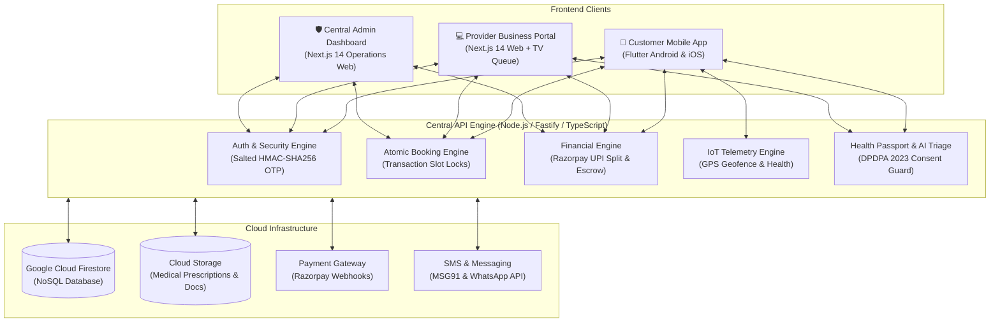
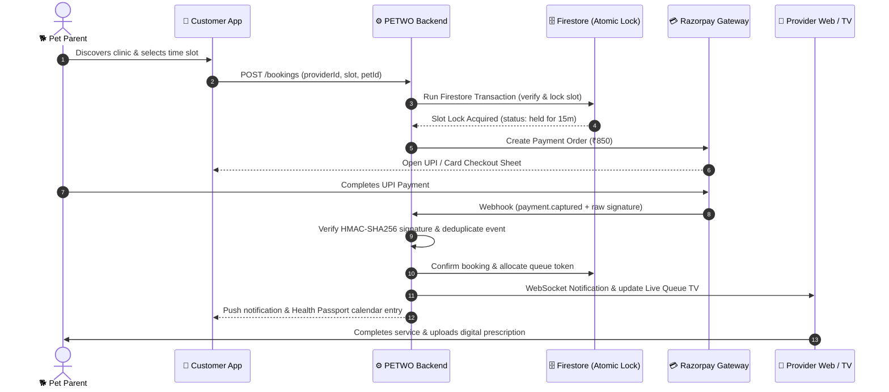
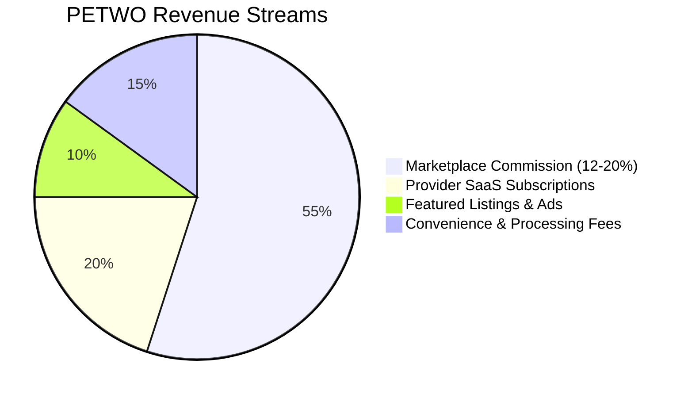
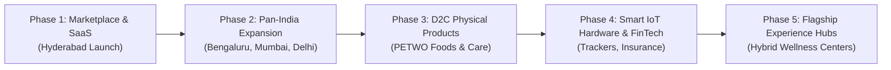

# PETWO — Company Overview, System Architecture & Vision

> **"Empowering Pet Parents. Elevating Pet Professionals. Transforming Pet Care Across India."**

---

## 1. Executive Summary & Startup Mission

**PETWO** is an India-first, hyper-local pet-care marketplace and enterprise multi-tenant SaaS platform. 

The Indian pet care market is experiencing unprecedented explosive growth (>25% CAGR), driven by urban nuclear families, pet humanization, and disposable income growth in major metro hubs. However, the ecosystem remains severely fragmented:
- **Pet Parents** struggle with unverified veterinarians, lack of pricing transparency, lost vaccination books, double-booked appointments, and zero emergency response coordination.
- **Pet Care Providers** (veterinarians, clinics, groomers, boarding facilities, and trainers) are burdened with pen-and-paper management, manual WhatsApp bookings, no-shows, delayed customer payments, and no modern practice management tools.

**PETWO bridges this divide.** We unify the entire lifecycle of pet care into a seamless digital ecosystem connecting pet parents, certified care providers, and platform administrators.

- **Initial Launchpad**: **Hyderabad, Telangana** (High-density pet ownership hubs: Banjara Hills, Jubilee Hills, Gachibowli, Madhapur, Kondapur, and Secunderabad).
- **Scale Horizon**: Tier-1 Metros (Bengaluru, Mumbai, Delhi-NCR, Pune, Chennai) $\rightarrow$ Tier-2 Urban Centers $\rightarrow$ International Emerging Markets.

---

## 2. Platform Architecture: The Three Connected Pillars

PETWO operates through three synchronized, high-performance applications powered by a central cloud engine.

### A. Customer Mobile App (Flutter)
Designed for busy pet parents with an intuitive, responsive mobile experience:
- **Instant Search & Discovery**: Map-based clinic, groomer, and boarding search with live distance, user ratings, and verified credentials.
- **Single-Tap Booking**: Choose between in-clinic visits, doorstep home services, or video teleconsultations with instant slot locking.
- **Unified Health Passport**: Centralized digital medical records, vaccination due dates, deworming alerts, and lab diagnostics.
- **Live IoT Pet Tracker**: Real-time GPS location tracking on map with geo-fence perimeter alerts (safe zone vs breach notifications).
- **Seamless UPI Payments**: Native Indian checkout via Google Pay, PhonePe, Paytm, cards, and net banking with instant booking confirmation.

### B. Provider Business Portal (Next.js 14 & TypeScript)
A complete practice management SaaS for individual vets, multi-branch clinics, pet salons, and boarding resorts:
- **Role-Based Practice Management**: Separate roles for clinic directors, attending vets, groomers, and front-desk receptionists.
- **Dynamic Yield Pricing & Calendars**: Custom slot durations, buffer times, holiday schedules, and peak-hour dynamic pricing.
- **Live Clinic TV Queue**: Dedicated fullscreen display for waiting-room TVs (`/queue/[locationId]`) showing currently serving tokens and estimated wait times.
- **Financial Reconciliation & Payouts**: Automated calculation of platform take-rates, net earnings, GST compliance, and T+2 direct bank settlements.

### C. Central Admin Operations Portal (Next.js 14 & TypeScript)
The command center for platform governance, quality assurance, and compliance:
- **Provider KYC & Vetting**: Review veterinary degrees, State Veterinary Council registration numbers, trade licenses, and facility photos before approving marketplace listings.
- **Marketplace Health & GMV Tracking**: Real-time Gross Merchandise Volume, take-rate revenue, active appointments, and customer retention metrics.
- **Support & Dispute Resolution**: Integrated grievance ticketing system for cancellations, no-show disputes, and refund approvals.
- **DPDPA 2023 Audit Ledger**: Tamper-evident logging of administrative actions, consent grants, and medical data access.

---

## 3. End-to-End System Demonstration: How It Works

Here is a step-by-step walkthrough of the core operational loop:

### Scenario 1: Booking a Veterinary Consultation
1. **Search**: Customer enters location (*"Banjara Hills, Hyderabad"*) and chooses *"Veterinary Care"*.
2. **Availability**: The system retrieves real-time open slots for Dr. Rao Pet Hospital, filtering out occupied or blocked times.
3. **Atomic Slot Hold**: When the user selects 11:30 AM, an atomic Firestore transaction locks `slotLocks/provider_loc_staff_time`. If another customer clicks at the same millisecond, the second customer receives a polite *"Slot just taken"* notification with zero double-booking risk.
4. **Razorpay Settlement**: User pays ₹850 via UPI. The webhook reconciles the transaction, retains PETWO's 15% platform commission (₹127.50), and queues the net provider balance (₹722.50) for settlement.
5. **Waiting Room Display**: The appointment immediately appears on the clinic's reception dashboard and the waiting-room TV display as **Token #08**.
6. **Digital Prescription**: Post-consultation, the vet enters clinical findings and uploads Rx directly to the pet's Digital Health Passport.

---

## 4. Current Platform Services

| Service Category | Operational Model | Target Providers | Key Features |
|---|---|---|---|
| **Veterinary Clinics & Hospitals** | In-clinic & OPD | Certified BVSc & MVSc Veterinarians | Health passport integration, digital prescription signing, medical history consent gating. |
| **Grooming & Spa** | In-salon & Doorstep Van | Certified Pet Stylists & Mobile Vans | Custom grooming packages (Bath, Haircut, Nail Trim, Tick Dip), breed-specific sizing. |
| **Boarding & Luxury Stays** | Overnight & Daycare | Pet Resorts, Crèches, Home Boarders | Real-time kennel inventory, daily photo/video updates, dietary preference tracking. |
| **Doorstep Home Services** | At-Home Provider Visit | Freelance Vets, Trainers & Walkers | GPS route tracking, doorstep delivery of care, geo-verified arrival check-in. |
| **Diagnostics & Labs** | Home Sample Collection | Certified Veterinary Diagnostic Labs | CBC, blood panels, digital report auto-sync to pet passport. |
| **Emergency & Ambulance** | 24/7 Rapid Response | Emergency Trauma Centers | 1-tap emergency dispatch, nearest open facility routing, triage priority alert. |
| **IoT Collar Telemetry** | Hardware-Software Sync | GPS Tracker Hardware | Real-time latitude/longitude, battery heartbeats, automated geofence boundary alerts. |

---

## 5. Startup Monetization & Unit Economics

PETWO generates high-margin revenue through four synchronized streams:

1. **Marketplace Take-Rate (12% to 20%)**: Retained automatically from every booking processed across veterinary, grooming, boarding, and training services.
2. **Provider SaaS Tiers**:
   - **Starter (Free)**: 1 location, 2 staff, basic scheduling.
   - **Growth (₹999/month)**: 3 locations, 10 staff, advanced business analytics, automated WhatsApp reminders, 2% commission discount.
   - **Pro Enterprise (₹2,499/month)**: Unlimited locations & staff, priority marketplace ranking, featured badge, dedicated account manager.
3. **Customer Platform Convenience Fees**: Nominal ₹15–₹29 booking fee per transaction for insurance guarantees, emergency response coverage, and 24/7 concierge support.
4. **Promotional Featured Placements**: Sponsored clinic listings on category search pages for providers wishing to accelerate their booking velocity.

---

## 6. The Future: Post-Launch Roadmap & Private Label Products

Upon establishing market density in Hyderabad and expansion cities, PETWO will leverage its customer trust, pet demographic data, and distribution channels to launch proprietary high-margin physical products and fintech verticals.

### Vertical 1: PETWO D2C Private Label Pet Products
Leveraging anonymized dietary, breed, and health data from our platform, we will formulate and retail clean-label, high-nutrition pet products:
- **PETWO Fresh Nutrition**: Human-grade, vacuum-cooked wet meals formulated with Indian veterinary nutritionists (tailored for Indie, Golden Retriever, German Shepherd, and Persian breeds).
- **Functional Treats & Supplements**: Joint-care chews (Glucosamine/Chondroitin), skin & coat omega supplements, and probiotic dental sticks.
- **Ayurvedic & Chemical-Free Pet Grooming**: Natural shampoos, neem tick repellents, paw balms, and ear cleaners manufactured in India.
- **Eco-Friendly Pet Accessories**: Bio-degradable waste bags, ergonomic hemp harnesses, orthopedic memory foam pet beds, and travel crates.

### Vertical 2: Proprietary Smart Hardware Line
- **PETWO Smart Collar 2.0**: Sleek, waterproof 4G LTE/GPS pet tracker with vital-sign monitoring (heart rate, resting respiratory rate, temperature) feeding real-time diagnostics directly into the PETWO app.
- **Automated RFID Feeders**: Microchip-reading portion-controlled pet feeders for multi-pet households.

### Vertical 3: Pet Health Insurance & Financial Products
- **PETWO Shield Insurance**: In partnership with leading IRDAI-registered Indian underwriters, offering 1-click cashless hospitalization coverage for accidents, tick fever, surgeries, and cancer treatments.
- **Pet Care Emergency Credit Line**: Instant zero-interest 3-month EMI for emergency surgeries and intensive care treatments.

### Vertical 4: PETWO Experience Hubs & Community
- **Flagship Urban Wellness Centers**: State-of-the-art hybrid clinics combining veterinary trauma care, grooming spas, dog parks, pet cafes, and community adoption drives under one unified brand.
- **Adoption & Stray Welfare Initiatives**: Automatic 1% platform revenue commitment towards stray animal vaccination, rabies eradication, and sterilization in partnership with local municipal bodies (GHMC).

---

## 7. Summary & Investment Highlights

- **Proprietary Technology**: Built on a reactive, event-driven TypeScript architecture with atomic concurrency controls, constant-time authentication, and full DPDPA 2023 regulatory compliance.
- **Defensible Network Effects**: As more clinics join, customer discovery becomes richer; as pet parents register their pets, providers gain irreplaceable medical history and client retention.
- **Capital Efficiency**: Dual-engine monetization (SaaS SaaS subscription MRR + transactional marketplace take-rates) ensures strong cash flow and rapid pathway to profitability.
- **Production Status**: **100% build-verified, type-safe, CI/CD automated, and cloud-ready for instant live deployment.**
