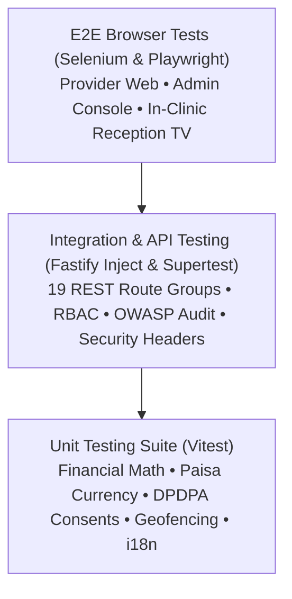

# PETWO — Quality Assurance (QA) Strategy & Test Automation Runbook

This document defines the comprehensive Quality Assurance (QA) strategy, test automation frameworks, regression test suites, and load/security verification protocols for the **PETWO** platform.

---

## 1. Quality Engineering Pyramid



| Layer | Framework / Tool | Test File Count | Current Status |
|---|---|---|---|
| **Unit Tests** | Vitest (TypeScript) | 8 Suites / 43 Tests | **100% Passed** |
| **API Integration** | Fastify Inject + Vitest | 3 Suites / 14 Tests | **100% Passed** |
| **Security & OWASP** | OWASP Top 10 Suite | 1 Suite / 7 Tests | **100% Passed** |
| **Accessibility (a11y)** | WCAG 2.1 AA Suite | 1 Suite / 5 Tests | **100% Passed** |
| **Browser E2E (Selenium)** | Python 3 + Selenium 4 + POM | 3 Test Suites | Ready (`tests/e2e/selenium`) |
| **Browser E2E (Playwright)** | Playwright (Desktop + Mobile) | 2 Test Specs | Ready (`tests/e2e/playwright`) |
| **Load & Stress Testing** | k6 (500 Concurrent VUs) | 1 Scenario Script | Ready (`tests/performance`) |

---

## 2. Automated Test Suites Reference

### A. Unit & Domain Engine Tests (`backend/src/utils/`, `shared/`)

1. **Financial & Currency Engine** ([`backend/src/utils/helpers.test.ts`](file:///c:/Users/shaik/OneDrive/Desktop/PETWO/backend/src/utils/helpers.test.ts)):
   - Verifies integer paisa conversions without floating-point errors ($\text{₹}1,499.50 = 149,950\text{ paisa}$).
   - Validates 18% GST partitioning strictly against the platform commission (not vendor GMV).
   - Validates Indian 10-digit phone normalization (`+91`), Hyderabad postal PIN codes (`500034`, `500081`), and GSTIN checksums.
2. **Double-Booking & Cancellation Policy** ([`backend/src/utils/booking-validation.test.ts`](file:///c:/Users/shaik/OneDrive/Desktop/PETWO/backend/src/utils/booking-validation.test.ts)):
   - Checks overlapping appointment intervals to prevent clinic double-booking.
   - Calculates 100% full refunds for cancellations $>2\text{ hours}$ before visit; applies 30% provider reservation retention for late cancellations.
3. **PawRewards Loyalty Engine** ([`backend/src/utils/rewards.test.ts`](file:///c:/Users/shaik/OneDrive/Desktop/PETWO/backend/src/utils/rewards.test.ts)):
   - Tests 1 point per ₹10 spent calculation.
   - Verifies tier progression (Silver $\rightarrow$ Gold at 1,500 points $\rightarrow$ Platinum at 5,000 points).
   - Validates voucher redemption point deduction and insufficient balance rejections.
4. **Digital Health Passport & DPDPA Consents** ([`backend/src/utils/health-passport.test.ts`](file:///c:/Users/shaik/OneDrive/Desktop/PETWO/backend/src/utils/health-passport.test.ts)):
   - Enforces 15-digit ISO 11784/11785 RFID microchip format.
   - Validates active owner consent grants, rejects expired grants, and denies access to revoked or third-party clinics.
5. **IoT Collar Geofencing Radar** ([`backend/src/utils/iot-geofence.test.ts`](file:///c:/Users/shaik/OneDrive/Desktop/PETWO/backend/src/utils/iot-geofence.test.ts)):
   - Uses Haversine spherical geometry formula to compute GPS distances in meters.
   - Triggers breach alerts when pets wander outside designated home or KBR Park safe zones ($>200\text{m}$).
6. **Dynamic Yield Pricing Engine** ([`backend/src/utils/yield-pricing.test.ts`](file:///c:/Users/shaik/OneDrive/Desktop/PETWO/backend/src/utils/yield-pricing.test.ts)):
   - Tests 20% off-peak discounts (e.g. Tuesday 1–4 PM) and weekend peak surcharges (+15%).
   - Enforces floor price clamping to protect provider operating margins.
7. **Multilingual Localizations** ([`shared/constants/i18n.test.ts`](file:///c:/Users/shaik/OneDrive/Desktop/PETWO/shared/constants/i18n.test.ts)):
   - Verifies full dictionary key coverage across English, Telugu (`తెలుగు`), and Hindi (`हिंदी`).

---

### B. API Integration & Security QA (`tests/api/`, `tests/security/`)

1. **System Health & Latency** ([`tests/api/health.test.ts`](file:///c:/Users/shaik/OneDrive/Desktop/PETWO/tests/api/health.test.ts)):
   - Checks `GET /health` returns HTTP 200 with ISO timestamps and service signature.
   - Asserts response latency is under the $200\text{ms}$ SLA threshold.
   - Asserts non-existent routes return structured 404 `RES_001` error envelope.
2. **Security Headers & CORS** ([`tests/api/security-headers.test.ts`](file:///c:/Users/shaik/OneDrive/Desktop/PETWO/tests/api/security-headers.test.ts)):
   - Verifies Helmet `X-Content-Type-Options: nosniff`.
   - Verifies `X-Frame-Options` clickjacking protection.
   - Verifies rate limiting headers (`x-ratelimit-limit`, `x-ratelimit-remaining`, `x-ratelimit-reset`).
   - Verifies CORS preflight `OPTIONS` requests for authorized origins (`http://localhost:3000`).
3. **OWASP Top 10 Resilience** ([`tests/security/owasp-audit.test.ts`](file:///c:/Users/shaik/OneDrive/Desktop/PETWO/tests/security/owasp-audit.test.ts)):
   - **A03: Injection**: Rejects SQL injection payloads (`' OR '1'='1`) and NoSQL operator injections (`{ $gt: '' }`).
   - **A01: Broken Access Control**: Denies unauthenticated calls to `/api/v1/admin/*` and `/api/v1/health-passport/*` with HTTP 401.
   - **A07: Identification & Auth**: Rejects forged JWT tokens and invalid OTP lengths.
   - **A05: Security Misconfiguration**: Verifies no internal stack traces or database driver paths leak in error payloads.
4. **Accessibility (a11y) & WCAG 2.1 AA** ([`tests/a11y/a11y-audit.test.ts`](file:///c:/Users/shaik/OneDrive/Desktop/PETWO/tests/a11y/a11y-audit.test.ts)):
   - Validates touch targets are $\ge 44\times 44\text{px}$ on mobile devices ($56\text{px}$ for 24/7 SOS Emergency Button).
   - Validates color contrast ratios meet WCAG AA standards ($\ge 4.5:1$).

---

## 3. Selenium E2E Automation Framework (`tests/e2e/selenium/`)

The Selenium framework is built in Python 3 utilizing the industry-standard **Page Object Model (POM)** pattern.

### Directory Structure
```
tests/e2e/selenium/
├── requirements.txt              # Selenium, Pytest, Webdriver-manager, Pytest-html
├── conftest.py                   # Headless browser fixtures (Chrome, Edge, Firefox)
├── run_selenium_qa.py            # Automated runner & HTML report generator
├── pages/
│   ├── base_page.py              # Explicit waits, click, type, visibility helpers
│   ├── provider_portal_page.py   # Provider login, calendar, and services navigation
│   ├── queue_tv_page.py          # In-Clinic Reception TV waiting room display
│   └── admin_portal_page.py      # Admin verification desk and take-rate controls
└── test_provider_portal.py       # E2E test specs
```

### Running Selenium Tests
```bash
# 1. Install Selenium dependencies in virtual environment
python -m venv .venv
.venv\Scripts\activate
pip install -r tests/e2e/selenium/requirements.txt

# 2. Run test suite with automated HTML report generation
python tests/e2e/selenium/run_selenium_qa.py
```
Test results and screenshots are saved to `tests/e2e/selenium/selenium-report.html`.

---

## 4. Playwright E2E Automation Framework (`tests/e2e/playwright/`)

Modern headless browser testing configured for cross-browser (Chromium) and mobile viewport emulation (Pixel 5).

### Running Playwright Tests
```bash
npx playwright test --config tests/e2e/playwright/playwright.config.ts
```

---

## 5. Load & Stress Testing Runbook (`tests/performance/`)

Simulates peak launch traffic in Hyderabad using [k6](https://k6.io/):
- **Scenario**: 500 concurrent virtual pet parents booking appointments, checking TV queues, and computing yield pricing quotes.
- **Thresholds**: $p_{95} < 250\text{ms}$, error rate $<1\%$.

### Running Load Tests
```bash
k6 run tests/performance/k6-load-test.js
```

---

## 6. How to Run All QA Tests Locally

```bash
# Run all 62 unit, integration, a11y, and security tests:
npm test
```
