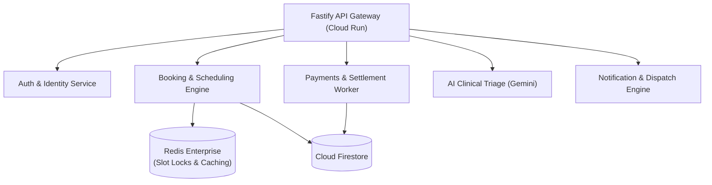

# PETWO — Roadmap, Extensions & Architectural Enhancements

This document outlines upcoming product extensions, advanced architectural upgrades, and the geographic expansion roadmap for PETWO.

---

## 1. High-Value Product Extensions

### 1.1 In-App Veterinary Pharmacy & Prescription Fulfillment
- **Concept**: Digital prescription (`RX-XXXXXX`) issued during a clinic visit or teleconsultation automatically populates a 1-click medicine basket.
- **Hyderabad Partner Network**: Integration with licensed veterinary pharmacies across Banjara Hills, Kukatpally, and Secunderabad for 2-hour doorstep delivery.
- **Compliance**: Adherence to Schedule H prescription drug validation under the Drugs and Cosmetics Act.

### 1.2 IoT Smart Collar & Pet Wearable Sync
- **Concept**: Bi-directional telemetry sync with GPS and activity tracking collars (e.g. Fi, Whistle).
- **Features**:
  - Real-time pet location tracking with safe-zone geofence breach alerts.
  - Daily activity tracking (steps, sleep quality, scratch index).
  - Anomaly detection: Spikes in itching or sudden drops in activity automatically trigger an AI Health Advisory recommending a consultation.

### 1.3 Complete Veterinary Practice Management System (PMS)
- **Concept**: Upgrading the Provider Web Portal from a booking receiver into an end-to-end in-clinic operating system:
  - **In-Clinic Waiting Room Display**: Real-time token queue screen for reception TVs.
  - **Comprehensive EHR**: Detailed surgical history, dental charting, and anesthesia monitoring records.
  - **Inventory & Pharmacy POS**: Expiry tracking for vaccines, batch-level barcode scanning, and low-stock alerts.

### 1.4 Pet Healthcare Insurance Marketplace
- **Concept**: Embedded health insurance for dogs and cats underwritten by licensed Indian general insurers (e.g. Bajaj Allianz, Digit).
- **Offerings**:
  - Emergency surgery & accident cover up to ₹1,00,000.
  - Outpatient diagnostic tests & blood panel reimbursement.
  - Cashless claim settlement directly across verified PETWO network hospitals in Hyderabad.

### 1.5 WhatsApp Business Interactive Bot
- **Concept**: Conversational booking and reminders via WhatsApp:
  - Automated vaccine booster reminders sent 7 days and 24 hours prior.
  - 1-click appointment confirmation / rescheduling via WhatsApp interactive list messages.
  - Emergency hospital routing initiated directly by sending live location on WhatsApp.

---

## 2. Architectural & Technical Enhancements

### 2.1 Dynamic Off-Peak Pricing & Yield Optimization
- **Mechanics**: Machine learning model running on Google Cloud Vertex AI to identify recurring idle capacity across partner clinics (e.g. Tuesday 2:00 PM – 4:30 PM).
- **Impact**: Automatically offers 10–20% discounts to pet parents during lull hours, increasing clinic slot utilization by up to 35%.

### 2.2 Microservice Decomposition Roadmap
As transaction volumes surpass 50,000 bookings/month, decompose the Fastify monolith into containerized Google Cloud Run services:

---

## 3. Geographic Expansion Strategy

| Phase | Geography | Launch Timeline | Operational Focus |
|---|---|---|---|
| **Phase 1** | **Hyderabad** | **Launch** | Banjara Hills, Jubilee Hills, Gachibowli, Kondapur, Madhapur, Secunderabad |
| **Phase 2** | **Bengaluru & Chennai** | **Q2** | Indiranagar, Koramangala, Whitefield, HSR Layout, Adyar, Anna Nagar |
| **Phase 3** | **Mumbai & Pune** | **Q3** | Bandra, Andheri, Powai, South Mumbai, Koregaon Park, Baner |
| **Phase 4** | **Delhi-NCR** | **Q4** | South Delhi, Gurugram Golf Course Rd, Noida Sector 62 |
