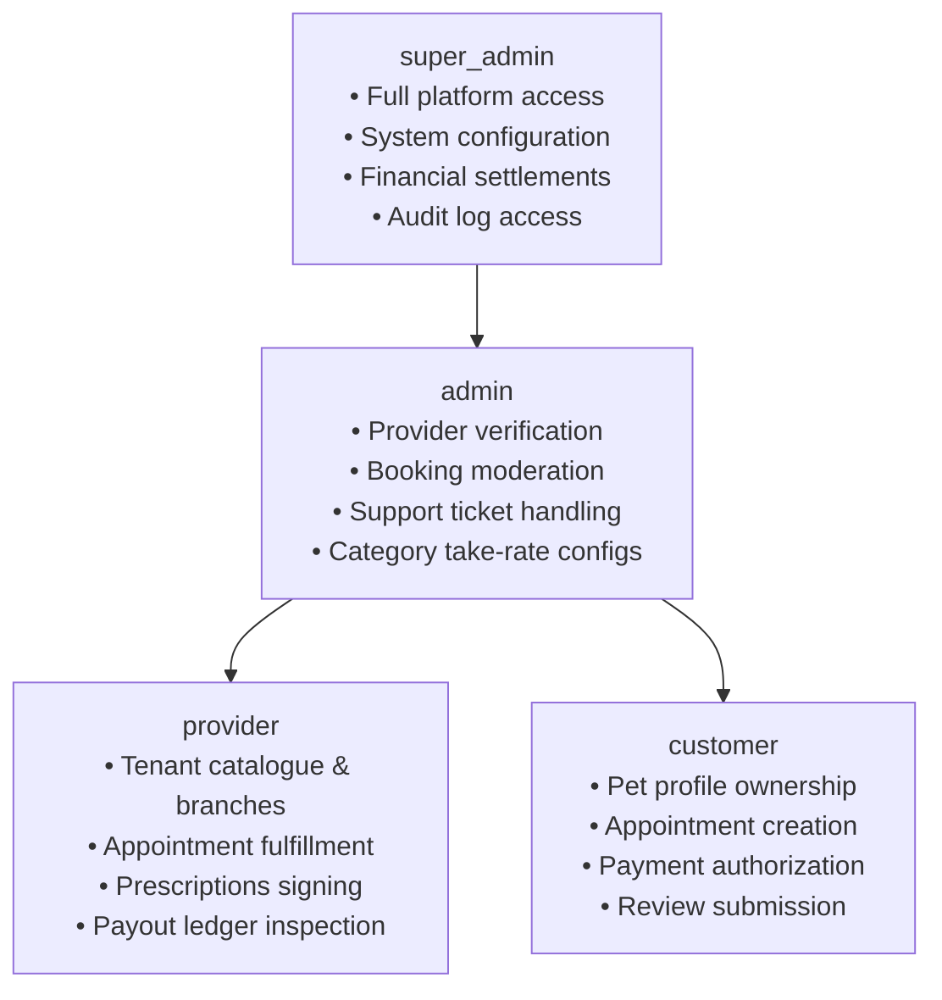

# PETCO — Security, Privacy & Regulatory Compliance

This document outlines the security architecture, role-based access control (RBAC), and regulatory compliance standards for PETCO operations in India under the **Digital Personal Data Protection Act (DPDPA 2023)** and **RBI Payment Aggregator guidelines**.

---

## 1. Authentication & Role-Based Access Control (RBAC)

The platform enforces 4 distinct hierarchical user roles:

### RBAC Permission Matrix

| Resource / Capability | Customer | Provider | Admin | Super Admin |
|---|---|---|---|---|
| Register / Edit Own Pets | ✅ | ❌ | ❌ | ❌ |
| View Pet Medical History | Own pets only | Authorized pets | ✅ | ✅ |
| Manage Clinic Services & Hours | ❌ | Own facility | ✅ | ✅ |
| Initiate Booking Checkout | ✅ | ❌ | ❌ | ❌ |
| Confirm / Progress Appointments | ❌ | Own facility | ✅ | ✅ |
| Generate Digital Prescriptions | ❌ | Verified Vets | ❌ | ❌ |
| Approve / Reject Provider Applications | ❌ | ❌ | ✅ | ✅ |
| Modify Commission Take-Rates | ❌ | ❌ | ✅ | ✅ |
| Trigger Payout Transfers | ❌ | ❌ | ❌ | ✅ |
| Inspect Security Audit Logs | ❌ | ❌ | ✅ | ✅ |

---

## 2. Database Security (Cloud Firestore Rules)

PETCO implements a **Deny-by-Default** security posture in `infrastructure/firebase/firestore.rules`:

1. **Zero Client-Side Financial Writes**:
   - Clients (Customer App / Provider Web) have **zero write access** to `bookings`, `payments`, `settlements`, or `coupons`.
   - All booking creation, state transitions, and payment captures are executed strictly by the authenticated Fastify API using the privileged `firebase-admin` SDK.
2. **Owner-Scoped Read Isolation**:
   - Customers can read only documents where `resource.data.customerId == request.auth.uid`.
   - Providers can read bookings where `resource.data.providerId == request.auth.uid`.
3. **Medical Record Confidentiality**:
   - Pet medical records and vaccination certificates are private to the pet owner.
   - An attending veterinarian receives read access exclusively when an active appointment exists between the clinic and that pet.
4. **Self-Approval Prevention**:
   - Providers updating their profile are cryptographically prevented from altering `verificationStatus` or `verifiedAt` keys via Firestore rule diff checks.

---

## 3. Financial Security & PCI-DSS Scope Reduction

1. **Zero Raw Card Storage**:
   - PETCO servers never ingest, transmit, or store Primary Account Numbers (PAN), CVVs, or bank net-banking passwords.
   - Payment capture is offloaded entirely to **Razorpay Standard SDK** running in secure browser/native client contexts.
2. **Cryptographic Webhook Verification**:
   - Razorpay server-to-server notifications are validated via `HMAC-SHA256` hashing using a 32-byte secret (`RAZORPAY_WEBHOOK_SECRET`).
   - Webhook processing is idempotent: duplicate delivery of a captured event does not trigger duplicate database state transitions or payouts.

---

## 4. DPDPA 2023 & Indian Data Privacy Compliance

1. **Consent Management**:
   - Pet parents give explicit opt-in consent for emergency medical records sharing with treating veterinary hospitals during booking confirmation.
2. **Right to Erasure (Soft-Delete & Purge)**:
   - When a user requests account deletion (`DELETE /customers/me`), customer credentials and profile links are immediately deactivated.
   - Per Indian taxation regulations (Section 44AA of Income Tax Act), financial transaction logs and booking invoices are retained in a cold, archived state for 7 financial years.
3. **PII Masking**:
   - Bank account numbers in provider dashboards are masked (e.g. `•••• •••• 9821`).
   - Customer phone numbers in provider appointment queues are routed through an in-app calling mask or WhatsApp business bridge to protect user privacy.

---

## 5. Network & Infrastructure Hardening

- **Fastify Helmet**: Secure HTTP response headers (Content-Security-Policy, Strict-Transport-Security, X-Frame-Options `DENY`).
- **CORS Whitelist**: Explicit origin restrictions matching verified domains (`https://petco.in`, `https://provider.petco.in`, `https://admin.petco.in`).
- **Distributed Rate Limiting**: Enforced via `@fastify/rate-limit` (100 requests per minute per IP / authenticated user) with exponential penalties for brute-force OTP attempts.
