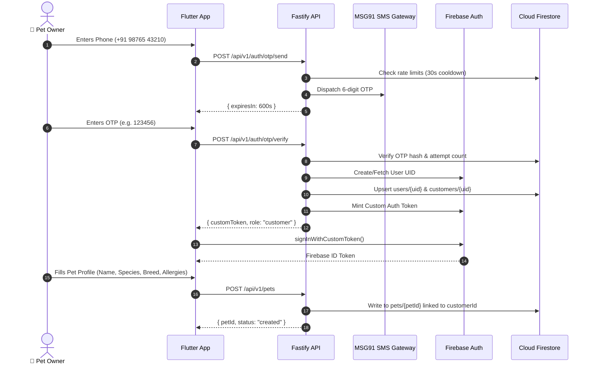
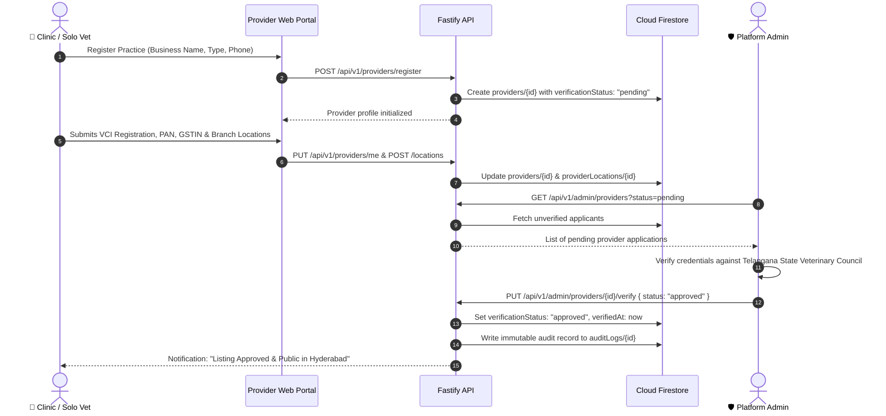
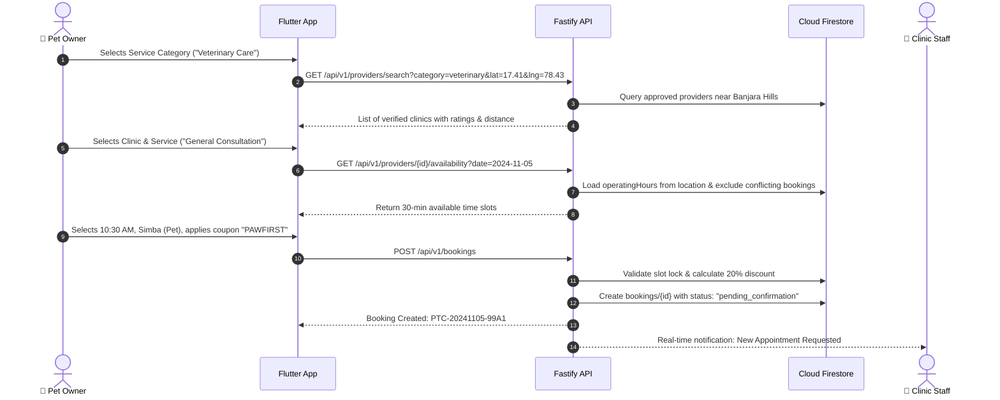
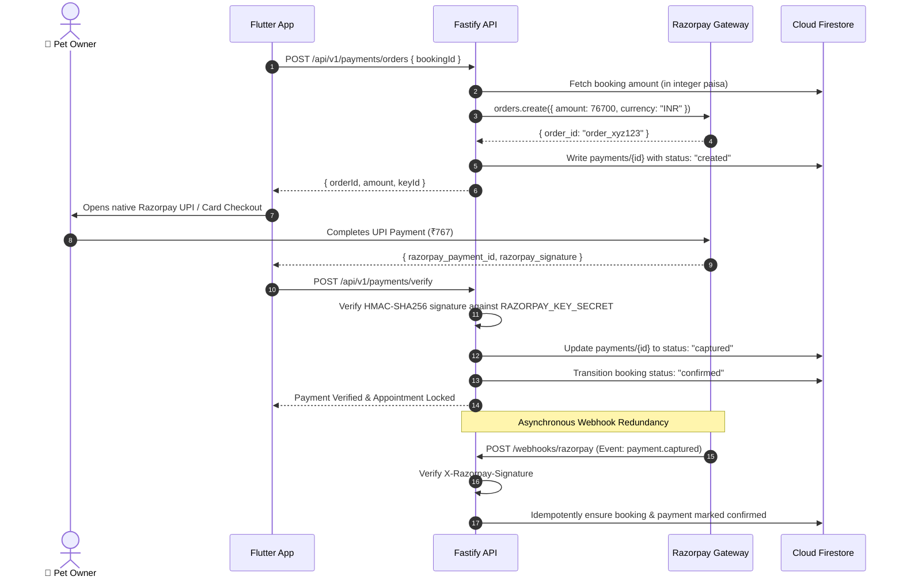
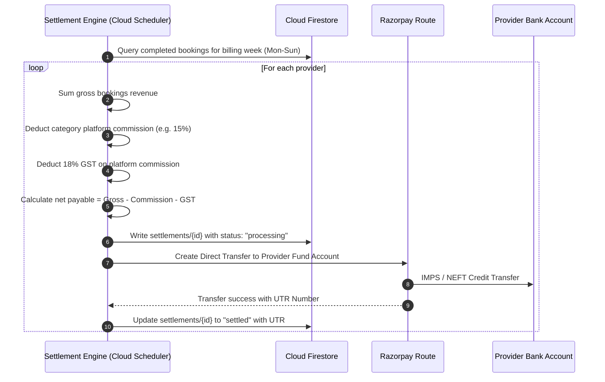
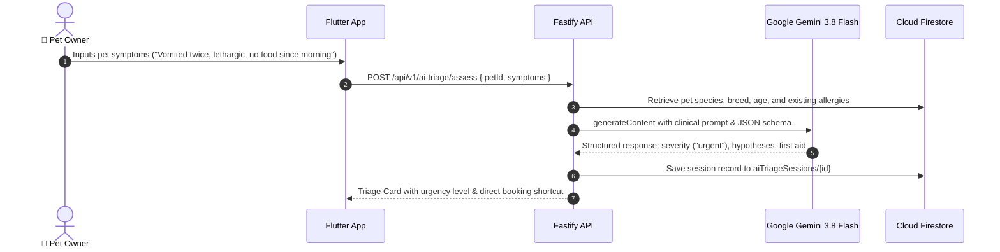
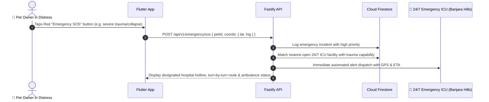
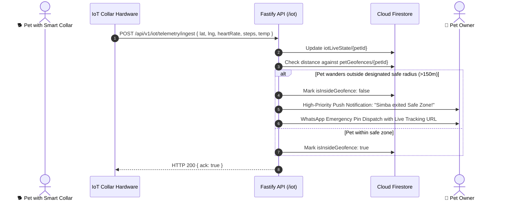
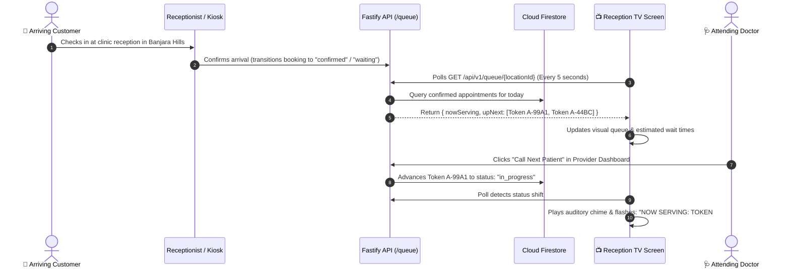
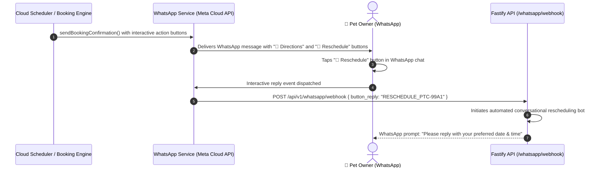

# PETCO — End-to-End Working Flows

This document details the lifecycle and sequence of operations across all core platform interactions.

---

## 1. Customer Authentication & Pet Registration

---

## 2. Provider Onboarding & Compliance Verification

---

## 3. Search, Discovery & Slot Booking

---

## 4. Payment Escrow & Razorpay Webhook Verification

---

## 5. Settlement Cycle & Weekly Vendor Payouts

---

## 6. AI Pet Symptom Triage with Gemini 3.8 Flash

---

## 7. 24/7 Emergency SOS Dispatch in Hyderabad

---

## 8. IoT Smart Collar Telemetry & Geofence Breach Workflow

---

## 9. In-Clinic Reception TV Waiting Room Queue Workflow

---

## 10. WhatsApp Business Notification & 1-Click Interactive Response

